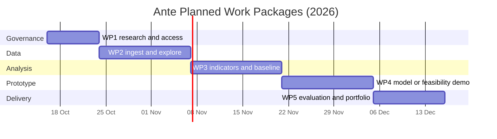

# Ante Work Plan and Risk Register (Draft)

This plan supports the course portfolio. Dates follow the proposal draft and remain subject to Moodle verification. Assigned people, meetings and outcomes will be recorded only after the team confirms them.

## Milestones

| Work package | Planned dates (2026) | Dependency | Exit evidence |
| --- | --- | --- | --- |
| WP1 Research and governance | 16–23 Oct | Team and scope decision | Source comparison, permission decision, schema, DMP, risk review |
| WP2 Ingestion and exploration | 24 Oct–6 Nov | Permitted data | Versioned adapter, data quality report, reproducible analysis, tests |
| WP3 Indicators and baseline | 7–20 Nov | WP2 quality gate | Time-window features, leakage tests, rule baseline, evaluation protocol |
| WP4 Model and analyst demo | 21 Nov–4 Dec | Permitted labels for predictive route | Holdout comparison with limits, or descriptive feasibility demo; API/UI with synthetic or approved records |
| WP5 Evaluation and portfolio | 5–15 Dec | WP1–4 evidence | Critical results, contributions, process record, public portfolio and rehearsal |

## Decision Gates

1. By 23 October, record the team, data owner, permitted fields, outcome-label provenance, storage location and retention decision. If labels are unavailable, use the descriptive feasibility route and state that a predictive claim is untested.
2. Before training, freeze the cohort, prediction time, label meaning and availability, outcome horizon, review capacity and holdout split. No held-out or later event may feed an earlier feature.
3. Before public release, check all text, code, charts and screenshots for individual player data, small cells, credentials and unsupported effectiveness claims.

## Risks and Responses

| Risk | Trigger/evidence to watch | Response | Decision owner |
| --- | --- | --- | --- |
| No permitted player data | No written permission or usable public dictionary | Use synthetic software tests and public-safe feasibility analysis; do not claim external validation | Team, pending |
| No trustworthy harm proxy | Labels absent, self-selected or inconsistently assessed | Document selection and uncertainty; show rules/feature feasibility only | Evaluation owner, pending |
| Future leakage | Feature after cutoff, label unavailable at evaluation time, shared train/test players | Enforce temporal and player checks; review source lineage and holdout protocol | ML owner, pending |
| Privacy exposure | Public record, ID, rare trajectory or individual score | Keep row data in ignored controlled storage, aggregate and disclosure-check outputs | Data owner, pending |
| Misleading interpretation | Score described as diagnosis, loss or measured harm reduction | Use human-review framing and measured proxy language; critical review before presentation | Team, pending |
| Schedule or contribution gaps | Cards without owners, evidence or review | Weekly recorded decisions and linked contributions; revise scope early | Coordinator, pending |

The Gantt dates are planned tasks, not proof of completed work. The [iteration log](iteration_log.md) records actual work and feedback.
